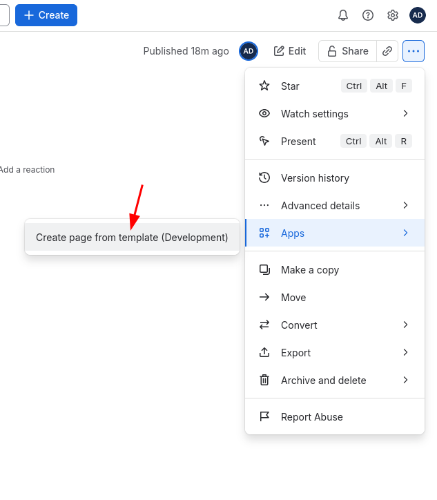
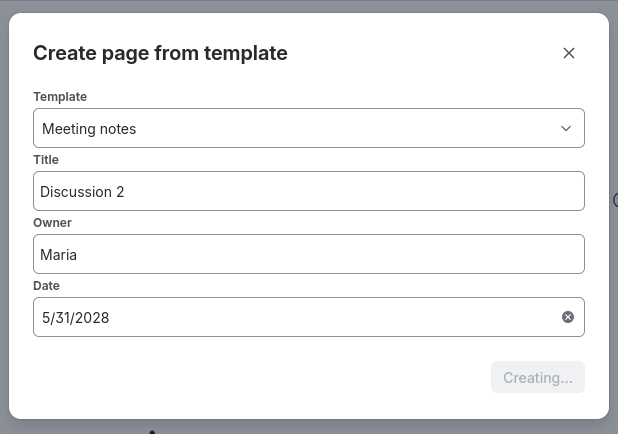
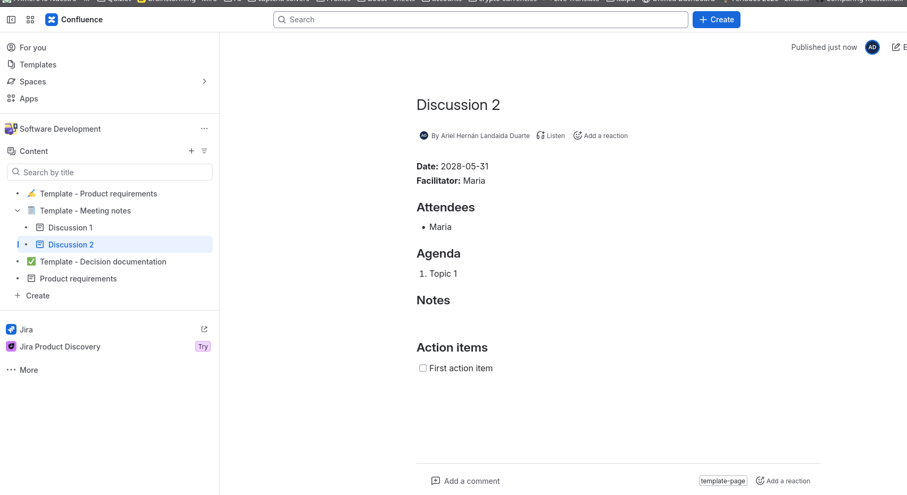
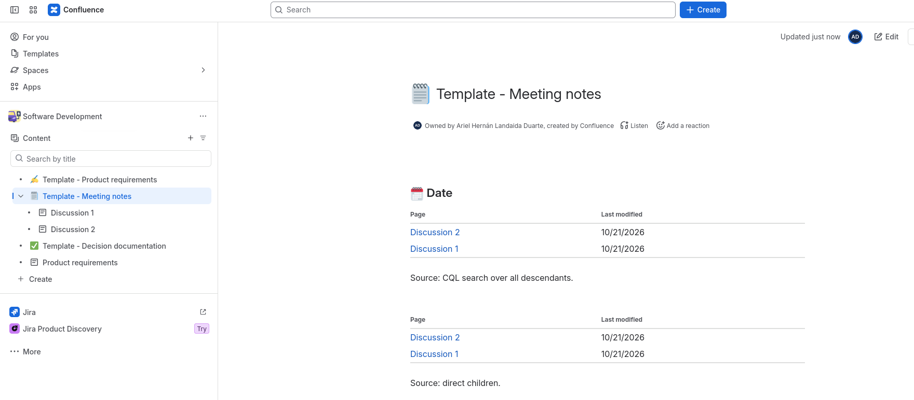

# Template Pages: a Forge rebuild of a Confluence blueprint

A small, working Atlassian **Forge** app for **Confluence Cloud** that shows how a classic Server/Data Center *blueprint* plugin (P2, `atlassian-plugin.xml`, Java + Soy templates) is rebuilt on Forge.

## Why Forge now

- **Connect** is on its way out: Atlassian has announced end of support for Connect apps, and Forge is the supported platform for new Cloud apps.
- **Server** is gone (end of support February 2024).
- **Data Center** end of sales is **2026-03-30** and end of life is **2029-03-28**.

If you own a P2 plugin for Confluence DC, the Cloud path is Forge. This repo is a compact reference for the shape of that migration.

## What the app does

1. **Content action** "Create page from template" (`confluence:contentAction`). Opens a UI Kit 2 modal. The user picks a bundled template (Meeting notes, Decision record, Runbook), fills in title, owner and date, and the app creates a **child page** of the current page through the Confluence REST API v2.
2. **Macro** "Template pages index" (`macro`, with `config: true`). Renders a UI Kit 2 `DynamicTable` of the pages created by the app, found through the label `template-page` that the app adds on creation. The macro configuration (`useConfig`) offers two sources: **direct children** read from the content store (instant, one REST call) or **all descendants** through a CQL search (deeper, but the search index can lag minutes behind page creation). Keeping both shows the trade-off a real migration hits: P2 plugins often queried the database directly; on Cloud you choose between the content API and the search index.

```
 Page menu: "Create page from template"
        |
        v
 [UI Kit 2 modal: Form]  --invoke('createPage')-->  [resolver]
   template / title /                                  |  validate input
   owner / date                                        |  render storage-format XHTML
                                                       |  GET  /wiki/api/v2/pages/{parent}   (space id)
                                                       |  POST /wiki/api/v2/pages            (child page)
                                                       |  POST /wiki/rest/api/content/{id}/label
                                                       v
                                               new child page, label "template-page"

 Macro "Template pages index" --invoke('listTemplatePages')--> [resolver]
   DynamicTable                                       v2 children+labels  |  v1 search?cql=... (macro config)
```

Everything runs as the current user (`api.asUser()`), so Confluence's own page permissions apply.

## P2 blueprint concept -> Forge equivalent

| P2 / Data Center concept | Forge equivalent in this repo |
|---|---|
| `atlassian-plugin.xml` | `manifest.yml` |
| `<blueprint>` + `<content-template>` | `confluence:contentAction` + resolver + `POST /wiki/api/v2/pages` with a storage-format body |
| Soy / Velocity templates | UI Kit 2 React components for the wizard; storage-format strings in `src/templates/*.js` for page content |
| `ContextProvider` Java class | Resolver function (`src/index.js`), which receives the product context in `req.context` |
| `web-item` (create dialog / page menu entry) | `confluence:contentAction` module |
| Wizard (`<dialog-wizard>`, pages and form validation) | UI Kit 2 `Form` in a modal, plus server-side validation in the resolver |
| i18n properties files | Forge has `translations` support in the manifest; this sample is **en-only** |
| OSGi / Spring components, Active Objects | Stateless functions plus Forge storage (KVS / Custom Entity Store) when state is needed (none here) |
| `<permission>` / servlet filters / `PermissionManager` | `permissions.scopes` in the manifest, plus `asUser()` so product permissions are enforced per user |
| Page macro (`<xhtml-macro>` + `Macro` class) | `macro` module with a UI Kit 2 front end |

## Project layout

```
manifest.yml                 modules, resources, scopes
src/index.js                 resolvers: listTemplates, createPage, listTemplatePages
src/frontend/action.jsx      modal (Form, Select, TextField, DatePicker)
src/frontend/macro.jsx       DynamicTable
src/templates/*.js           { key, name, fields, render(values) } per template
```

## Setup

Requires Node.js 22 and an Atlassian Cloud site with Confluence where you can install development apps.

```bash
npm install
npm i -g @forge/cli
forge login               # or export FORGE_EMAIL / FORGE_API_TOKEN for non-interactive use
forge register "Template Pages" -y   # first run also creates your Developer Space; replaces app.id in manifest.yml
npm run lint              # forge lint
forge deploy -e development --non-interactive
forge install --site your-site.atlassian.net --product confluence -e development --non-interactive --confirm-scopes
```

After a scope change in the manifest, run `forge install --upgrade` and approve the new permissions. During development `forge tunnel` gives you live reload.

## Try it

1. Open any Confluence page.
2. Open the page's "more actions" menu and choose **Create page from template**.
3. Pick "Decision record", fill in the fields and submit. The page reloads and the new child page appears in the page tree.
4. Edit the parent page, type `/Template pages index` and insert the macro. Its configuration panel lets you pick direct children or all descendants (CQL). It lists the pages carrying the `template-page` label.

## Limitations

- Templates are bundled in the app; users cannot add or edit their own.
- No template versioning: changing a template only affects pages created afterwards.
- Only pages below the one holding the macro are listed (direct children, or all descendants in CQL mode).
- Labelling uses the v1 content API because v2 has no endpoint for adding labels at the time of writing.
- The scope list above passed `forge lint` and `forge deploy` on Forge CLI 14.2 (October 2026); re-check it against the current REST docs when you add endpoints.
- UI strings are English only.

## Screenshots

Running on a Confluence Cloud development site.

| | |
|---|---|
|  |  |
| The action under the page's **···** → **Apps** menu | The UI Kit 2 modal: template, title, owner, date |
|  |  |
| The child page rendered from the Meeting notes template, labelled `template-page` | The index macro inserted twice: CQL search over all descendants, and direct children |

## Migration notes

- **Classic vs granular scopes.** The v1 content endpoints (`/wiki/rest/api/content/...`) want the classic `read:confluence-content.*` scopes; an app declared with granular v2 scopes (`read:page:confluence`) gets `401 scope does not match` on them. Stay on `/wiki/api/v2/` wherever it covers the need (here: children, labels, bulk pages), and keep v1 only for what v2 lacks (CQL search, adding a label).

- **`asUser()` vs `asApp()`.** The content action uses `asUser()` so the new page has the real author and respects the user's permissions; the macro uses `asApp()` because it renders for every reader and `asUser()` would ask each of them to grant consent. After a scope change, users must re-consent, which is visible as an "Allow access" prompt.: gotchas from DC to Forge

1. **No server-side Java.** Backend logic becomes JavaScript functions (Node.js runtime). Anything that depended on in-process Java APIs (`PageManager`, `SpaceManager`, event listeners) turns into REST calls or Forge product events and triggers.
2. **Function time limits.** Resolvers have a hard timeout (25 seconds by default). Long jobs, such as bulk page creation, need the async events queue (`@forge/events`) or a scheduled trigger instead of a long-running request.
3. **No direct database.** Active Objects and raw SQL are gone. Use Forge storage (key-value or Custom Entity Store), keeping in mind per-key size limits and query patterns, or keep data in Confluence itself (properties, labels, pages).
4. **Egress is declared.** Calls to anything outside Atlassian need `permissions.external.fetch` entries in the manifest, and data egress shapes your "Runs on Atlassian" eligibility. This sample makes no external calls.
5. **Rate limits and pagination.** REST APIs are rate limited and cursor-paginated; the DC habit of loading everything in one call does not carry over. Cap result sizes (this sample uses `limit=50`).
6. **UI Kit vs Custom UI.** UI Kit 2 renders with Atlassian components and needs no front-end hosting, which suits forms and tables like these. Choose Custom UI (your own React bundle in an iframe) when you need full control of layout, rich editors or non-Atlassian components, and accept the extra work on theming and bridge calls.
7. **Scopes replace roles.** Request the narrowest granular scopes, and prefer `asUser()` over `asApp()` so the app never reaches content the user cannot see.

## License

MIT. See [LICENSE](LICENSE).
